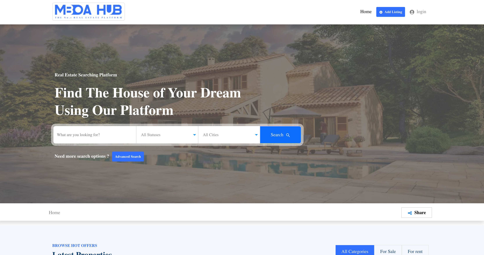

# Mboahub Backend API



Welcome to the Mboahub Real Estate Marketplace Backend API! This API serves as the backend for the Mboahub application built using Ruby on Rails and PostgreSQL. It provides endpoints for managing properties, users, and other essential functionalities of the application.

## Features

- User Authentication: Sign up, login, and manage user accounts securely.
- Property Management: Create, update, and delete property listings.
- Search and Filters: Utilize search and filters to find properties based on various criteria.
- Favorites: Allow users to save properties to their favorites list.
- API Documentation: Access comprehensive API documentation via Swagger/OpenAPI.

## Prerequisites

- Ruby [version]
- Rails [version]
- PostgreSQL [version]
- Bundler [version]

## Installation

1. Clone the repository:
   ```bash
   git clone https://github.com/ngodi/mboahub.git
   ```

2. Install dependencies:
   ```bash
   cd mboahub
   bundle install
   ```

3. Set up the database and run migrations:
   ```bash
   rails db:create
   rails db:migrate
   ```

4. Start the server:
   ```bash
   rails server
   ```

5. The API should now be accessible at `http://localhost:3000`.

## API Endpoints

For detailed API documentation and available endpoints, visit: [API Documentation](https://mboahub.com/api-docs)

## License

This project is licensed under the [MIT License](https://opensource.org/licenses/MIT).

## Contact

For any inquiries or support, please contact us at albertngodi@gmail.com.

---
 Happy coding! 😊
